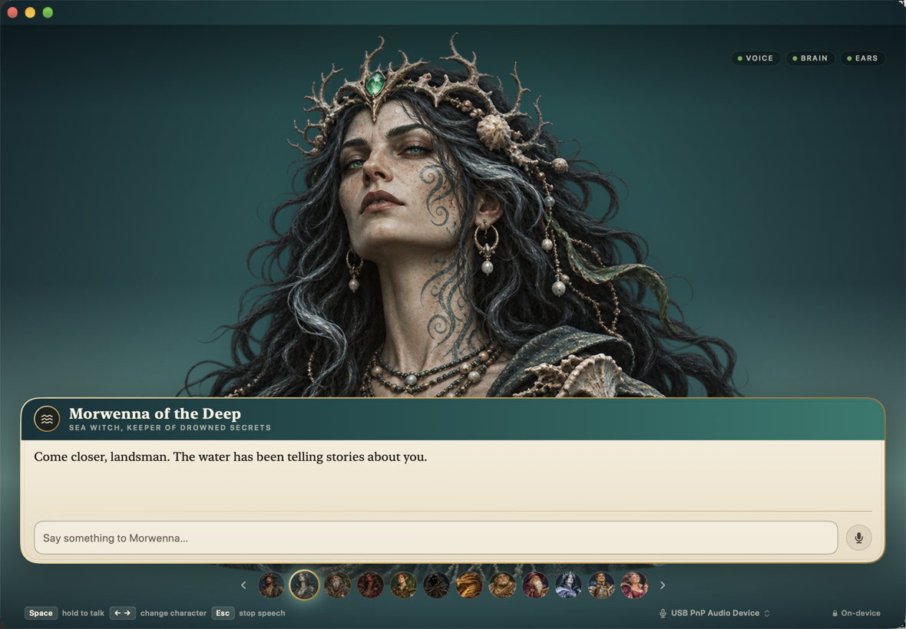

# Phonon Characters

A macOS character stage. Twelve Gradium character voices, a local LFM3 1.7B brain, and
Phonon-2.5 English live speech recognition. Everything runs on the machine; models download
on first launch. Characters are painted, not photographed: the `.dmg` is code and art.



## Requirements

- Apple silicon Mac (M1 or newer), macOS 15+
- ~2.4 GB free for the voice (131 MB), brain (1.05 GB), and optional ears (158 MB + 470 MB runtime)
- Microphone permission if you want to hold Space and talk

## Build

```bash
brew install xcodegen        # once
make dmg                     # release app + dist/PhononCharacters-1.0.dmg
make run                     # build and launch
```

`make` on its own lists targets (`debug`, `logs`, `models`, `notarize`, `clean`).

The build is ad-hoc signed. To notarize, see `Packaging/notarize.sh`.

The app bundles the llama.cpp runtime (`Resources/llama`, arm64, pinned b12032 / v0.8.0).
Model weights are never bundled.

## How it works

| Piece | Model | Transport |
|---|---|---|
| Voice | Phonon 31M Core ML, 12 character voices | in-process `PhononTTS` |
| Brain | LFM3 1.7B Q4_K_M | bundled `llama serve`, OpenAI chat |
| Ears | Phonon-2.5 English (Fermion, MLX) | `fermion serve`, live WebSocket |

- TTS streams 80 ms chunks; a reply starts speaking on its first sentence.
- Characters are full-bleed painted portraits (`Resources/Characters/<id>/portrait.png`),
  one per persona, with a procedural ink fallback (`Features/Stage/InkFace.swift`) when
  a portrait is missing. The stage keeps the image's original landscape composition; the
  voice drives breathing and sway, not the lips.
- Each character stands in a scene (`Core/CharacterScene.swift`,
  `Features/Stage/SceneLayer.swift`): a backdrop, one prop, drifting motes and wind,
  drawn from the same palette. The scenery moves while the character is idle and
  lifts with the voice; Reduce Motion freezes it.
- Holding **Space** interrupts the character, records, and shows a live transcript
  (partials roughly every 0.5 s) before sending on release.
- `←` / `→` change character, `Esc` stops speech, `Return` sends.
- The footer microphone button cycles the input used by push-to-talk; Settings lists them all.
- If a hold captures no audio, the app says which input was silent and offers to switch to the
  built-in microphone in one click.

## First launch

1. **Voice** and **Brain** are required. They download to
   `~/Library/Application Support/PhononCharacters/Models` (and Phonon's own folder).
2. **Ears** is optional. The first enable installs a 470 MB Python/MLX runtime into
   `…/PhononCharacters/Ears`, then Fermion fetches the 158 MB model into `~/.cache/fermion`.
3. Nothing is uploaded. The app works offline after setup.

Logs: `~/Library/Application Support/PhononCharacters/Logs`.

## Known limits

- arm64 only: the Phonon Core ML core is compiled for Apple silicon.
- Ad-hoc signed builds require right-click → Open the first time. Notarize for a clean open.
- The ears engine needs `uv` or downloads a pinned static `uv` on first install.
- Character art is one bundled portrait per persona
  (`Resources/Characters/<id>/portrait.png`, 1504×1046, transparent background)
  with a procedural ink fallback. The portrait is static; there is no lip-sync.
- The default input may be a USB or virtual device with no signal. Pick the built-in
  microphone from the footer menu; the app also detects a silent input and says so.

## Credits

- Phonon 31M and the voice catalogue — Gradium, Apache 2.0
- LFM3 1.7B — Liquid AI, LFM Open License
- Phonon-2.5 English — Fermion Research, CC-BY-4.0 (Parakeet TDT derivative)
- Runtime — llama.cpp (MIT), Phonon runtime (MIT / Apache 2.0), Fermion engine (Apache 2.0)
